# Email Triage Flow & Label Architecture

This document maps the end-to-end user flow and automated lifecycle for AI email triage in Google Workspace Automator, detailing every decision point, state transition, and label mutation.

---

## 1. End-to-End Triage Flow Diagram

```mermaid
flowchart TD
    Start(["Trigger: aiSorter (Daily 06:00)"]) --> CheckBacklog["Query Pending Actions<br/><code>label:Digest/Pending-Action -in:trash</code>"]

    CheckBacklog --> BacklogDecision{"Pending Count &ge;<br/>DAILY_LIMIT (50)?"}

    %% Capacity Exhausted Branch
    BacklogDecision -- "Yes (Remaining = 0)" --> SendBacklogDigest["Send Backlog-Only Digest<br/>• Alerts user that limit is reached<br/>• Links to Actions Page Web App"]
    SendBacklogDigest --> TagDigestBacklog["Label Digest Thread<br/><b>Auto-Recycle/1d</b>"]
    TagDigestBacklog --> EndNoOp(["End Run (No new mail processed)"])

    %% Processing Branch
    BacklogDecision -- "No (Remaining > 0)" --> CascadeSelect["Cascade Thread Selection<br/>Capacity = DAILY_LIMIT - Pending Count<br/>Filters: <code>-label:🪄✨ Magic ✨🪄</code>"]

    subgraph CascadePools["Selection Cascade Pools"]
        direction TB
        Pool1["1. Unread Inbox (up to 60% budget)<br/><code>in:inbox is:unread -label:'🪄✨ Magic ✨🪄'</code>"]
        Pool2["2. Old Inbox (shuffled, fills inbox budget)<br/><code>in:inbox -label:'🪄✨ Magic ✨🪄'</code>"]
        Pool3["3. Large Non-Inbox (shuffled, 20% budget)<br/>Probes 10M &rarr; 5M &rarr; 2M &rarr; 1M &rarr; 500K"]
        Pool4["4. Archived Mail (shuffled, absorbs remainder)<br/><code>in:anywhere -in:inbox -in:trash -in:spam</code>"]
    end

    CascadeSelect --> CascadePools
    CascadePools --> Extract["Extract Snippets & Metadata<br/>• Subject, sender, domain<br/>• First 300 chars of body<br/>• Age, size, attachments, unsubscribe links"]

    Extract --> Gemini["Gemini Flash Batch Classification<br/>Determines category, timeSensitive,<br/>actionRequired, duplicateOfId, summary"]

    Gemini --> DirectiveRules{"Evaluate Triage Rules<br/>(Rules Engine)"}

    %% Rule 1
    DirectiveRules -- "Rule 1: Time-Sensitive &<br/>Age &ge; 7 Days (Stale)" --> QueueRecycleOnly["Directive: recycle-7d-only<br/>• Skip triage category label<br/>• Queue for recycling"]

    %% Rule 2
    DirectiveRules -- "Rule 2: Ephemeral Category<br/>(newsletters)" --> QueueLabelAndRecycle["Directive: apply-label-and-recycle-7d<br/>• Set triage category label<br/>• Queue for recycling"]

    %% Rule 3
    DirectiveRules -- "Rule 3: Retain Category<br/>(personal, finance, govt, receipts)" --> QueueLabelOnly["Directive: apply-label-only<br/>• Set triage category label<br/>• Retain for user review"]

    %% Execution & Label Application
    QueueRecycleOnly --> ApplyRecycleLabel["Add Label: <b>Auto-Recycle/7d</b>"]
    QueueLabelAndRecycle --> ApplyTriageLabel["Add Label: <b>triage/&lt;category&gt;</b>"]
    ApplyTriageLabel --> ApplyRecycleLabel
    QueueLabelOnly --> ApplyRetainLabel["Add Label: <b>triage/&lt;category&gt;</b>"]

    ApplyRecycleLabel --> ApplyPendingLabel["Add Label: <b>Digest/Pending-Action</b><br/>(Applied to ALL processed threads)"]
    ApplyRetainLabel --> ApplyPendingLabel

    ApplyPendingLabel --> ApplyMagicLabel["Add Label: <b>🪄✨ Magic ✨🪄</b><br/>(Via labelProcessed for Gmail-AI-Sorter)"]

    ApplyMagicLabel --> ComposeDigest["Group Duplicates & Compose Daily Digest<br/>• Categorized thread summaries<br/>• Direct Gmail search links per label<br/>• Actions Page Web App deep link"]

    ComposeDigest --> SendDigest["Send Daily Email Digest to Account Owner"]
    SendDigest --> TagDigest["Scheduled Trigger: labelDigestForRecycle<br/>Add Label: <b>Auto-Recycle/1d</b> to digest"]

    TagDigest --> AwaitDecision(["Threads Triaged & Awaiting User / Auto Action"])

    %% Downstream User & Automated Actions
    subgraph DownstreamLifecycle["Downstream Resolution & Lifecycle"]
        direction TB

        %% Path A: Actions Page Web App
        ActionsPage["User Opens Actions Page Web App (doGet)<br/>Queries: <code>label:Digest/Pending-Action -in:trash</code>"]

        ActionsPage --> UserArchive["User clicks Archive"]
        UserArchive --> DoArchive["Archive thread in Gmail &<br/>Remove Label: <b>Digest/Pending-Action</b>"]

        ActionsPage --> UserDelete["User clicks Delete"]
        UserDelete --> DoDelete["Move thread to Trash (moveToTrash)"]

        %% Path B: Direct Gmail Action
        GmailDirect["User Reviews Directly in Gmail<br/>via Digest Category Links"]
        GmailDirect --> ManualClean["User manually archives, stars, or deletes"]

        %% Path C: Scheduled Recycle
        RecycleTrigger["Scheduled Trigger: recycle (Twice Daily)<br/>Finds threads in <code>Auto-Recycle/*</code> older than period"]
        RecycleTrigger --> AutoTrash["Add Label: <b>🪄✨ Magic ✨🪄/♻️</b><br/>Move thread to Trash (moveToTrash)"]
    end

    AwaitDecision -.-> ActionsPage
    AwaitDecision -.-> GmailDirect
    AwaitDecision -.-> RecycleTrigger
```

---

## 2. Where Labels Are Added & Modified

| Step / Location | Code Reference | Label Applied or Removed | Trigger Condition |
| :--- | :--- | :--- | :--- |
| **Triage Execution (Category Tagging)** | `executeTriageActions` in [src/Gmail/actionExecutor.ts](src/Gmail/actionExecutor.ts) | `triage/<category>` (Added) | Applied when email matches Rule 2 (newsletters) or Rule 3 (personal, finance, govt, receipts). Skipped for Rule 1 (time-sensitive stale). |
| **Triage Execution (Auto-Recycle Queue)** | `executeTriageActions` in [src/Gmail/actionExecutor.ts](src/Gmail/actionExecutor.ts) | `Auto-Recycle/7d` (Added) | Applied when email matches Rule 1 (time-sensitive & age $\ge 7$ days) or Rule 2 (`newsletters`). |
| **Triage Execution (Pending Queue)** | `executeTriageActions` in [src/Gmail/actionExecutor.ts](src/Gmail/actionExecutor.ts) | `Digest/Pending-Action` (Added) | Added unconditionally to **every** non-dry-run thread processed during triage. |
| **Triage Execution (Processing Marker)** | `labelProcessed` in [src/Gmail/actions/labelAsProcessed.ts](src/Gmail/actions/labelAsProcessed.ts) | `🪄✨ Magic ✨🪄` (Added) | Applied to all successfully mutated threads to mark them as completed. |
| **Digest Delivery (Digest Auto-Recycle)** | `labelDigestForRecycle` in [src/_s/Gmail/label-digest-for-recycle.ts](src/_s/Gmail/label-digest-for-recycle.ts) | `Auto-Recycle/1d` (Added) | Applied by scheduled trigger to threads matching subject `Daily Email Digest`. |
| **Actions Page (User Archive)** | `archiveDigestThread` in [src/Gmail/digestActionResolver.ts](src/Gmail/digestActionResolver.ts) | `Digest/Pending-Action` (Removed) | Removed when user clicks **Archive** on the Web App (thread is archived, pending label removed). |
| **Actions Page (User Delete)** | `deleteDigestThread` in [src/Gmail/digestActionResolver.ts](src/Gmail/digestActionResolver.ts) | None (Thread Trashed) | Thread moved to Trash via `moveToTrash()`, implicitly removing it from pending searches (`-in:trash`). |
| **Auto-Recycle Sweep (Recycle Marker)** | `recycle` in [src/_s/Gmail/recycle.ts](src/_s/Gmail/recycle.ts) | `🪄✨ Magic ✨🪄` (Added) | Applied by `recycle()` to expiring threads before moving them to Trash. |

---

## 3. Label Catalog & Significance

### 3.1 Pipeline State & Marker Labels

- **`🪄✨ Magic ✨🪄`**
  - **Significance**: Permanent audit and idempotency marker indicating that the thread has been triaged or recycled by an automator script.
  - **Function**: Prevents threads from ever being re-queried or re-processed in subsequent daily cascade selections (via query filter `-label:"🪄✨ Magic ✨🪄"`). Flattened to a single label to eliminate unnecessary sub-label clutter in Gmail.

- **`Digest/Pending-Action`**
  - **Significance**: Active lifecycle backlog tracking label. Signifies that the thread has been classified and included in a digest, but the user has not yet resolved it.
  - **Function**:
    1. Powers the Actions Page Web App (`label:Digest/Pending-Action -in:trash`), presenting the user with their pending decisions.
    2. Enforces backlog backpressure: `remainingCapacity = max(0, DAILY_LIMIT - pendingCount)`. If pending threads equal or exceed the daily limit ($50$), triage pauses further ingestion until the backlog is cleared.
  - **Removal**: Explicitly stripped when the user clicks **Archive** on the Actions Page, or naturally excluded when trashed.

---

### 3.2 Triage Category Labels (`triage/*`)

Each email is categorized into one of five temporary staging categories awaiting manual review:

| Label | Category Meaning | Triage Rule & Treatment |
| :--- | :--- | :--- |
| **`triage/personal`** | Direct personal emails, correspondence from people known to the user, and automated alerts / 2FA / monitoring notifications. | **Rule 3 (Retain)**: Label applied. Retained in inbox/archive for user review and filing to permanent labels. |
| **`triage/finance`** | Invoices, banking statements, payment receipts, investment updates. | **Rule 3 (Retain)**: Label applied. Retained for user review and filing to permanent finance labels. |
| **`triage/govt`** | Government agencies, legal notices, tax authorities, bureaucratic correspondence. | **Rule 3 (Retain)**: Label applied. Retained for user review and filing to permanent labels. |
| **`triage/receipts`** | Commercial order confirmations, shipping notices, retail receipts. | **Rule 3 (Retain)**: Label applied. Retained for user review and filing to permanent receipt labels. |
| **`triage/newsletters`** | Marketing campaigns, periodic news digests, promotional broadcasts. | **Rule 2 (Ephemeral)**: `triage/newsletters` applied **and** paired with `Auto-Recycle/7d`. Trashed after 7 days if unread/unrescued. |

---

### 3.3 Auto-Recycle Labels (`Auto-Recycle/*`)

- **`Auto-Recycle/7d`**
  - **Significance**: 7-day grace period countdown label for disposable or time-sensitive stale mail.
  - **Application Scenarios**:
    - **Rule 1 (Time-sensitive & stale)**: If an email is time-sensitive and already $\ge 7$ days old, the category label is skipped entirely, and `Auto-Recycle/7d` is applied directly.
    - **Rule 2 (Ephemeral categories)**: Co-applied with `triage/newsletters`.
  - **Lifecycle**: Twice daily, the `recycle` scheduled task scans `label:Auto-Recycle/7d older_than:7d -in:trash`. Any matching threads are tagged `🪄✨ Magic ✨🪄` and moved to Trash.

- **`Auto-Recycle/1d`**
  - **Significance**: 1-day retention policy applied to daily digest emails.
  - **Lifecycle**: The `labelDigestForRecycle` job finds threads with subject `Daily Email Digest` and applies `Auto-Recycle/1d`. After 24 hours, the `recycle` job cleans them up to keep the mailbox clutter-free.
